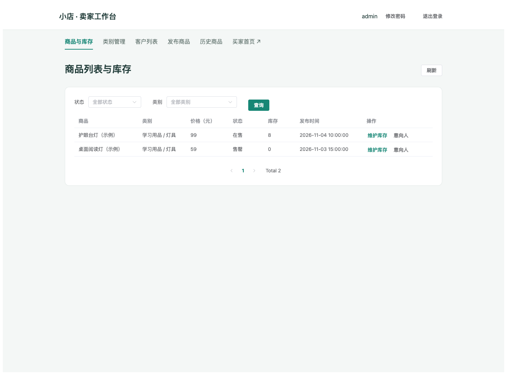
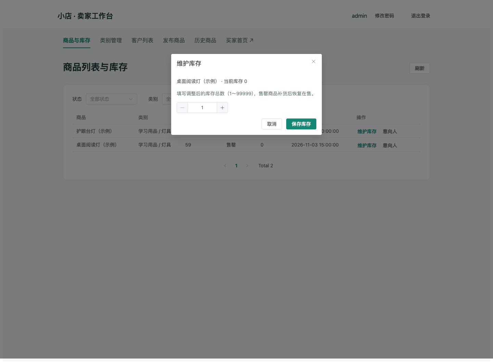
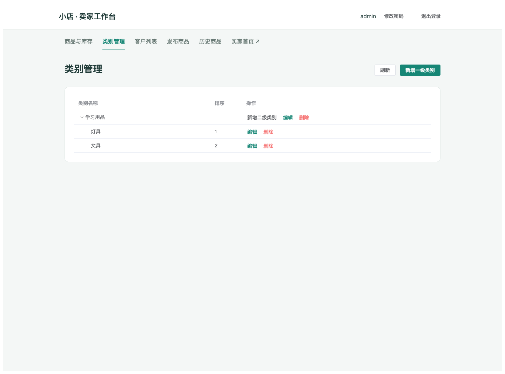
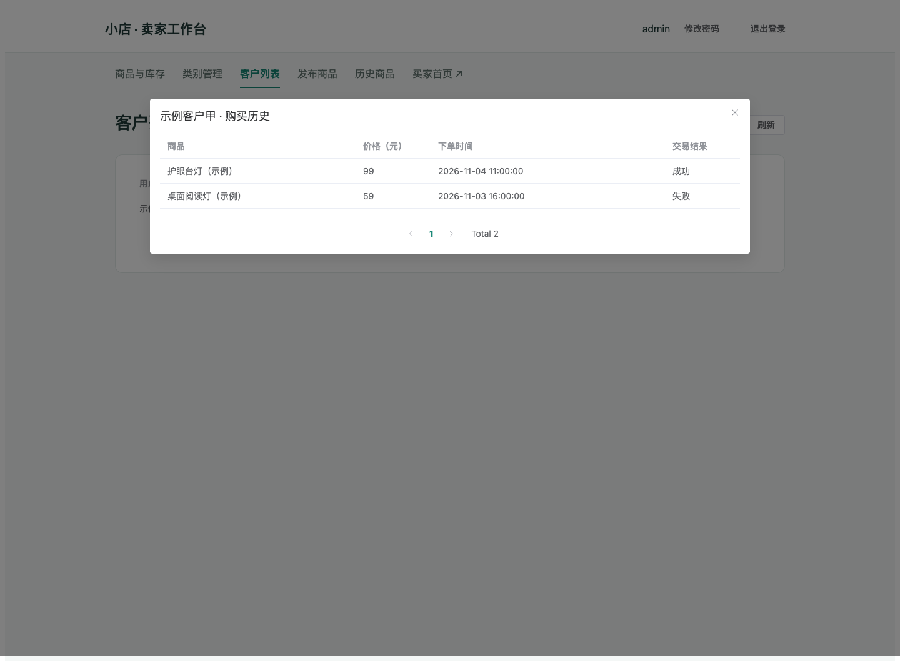
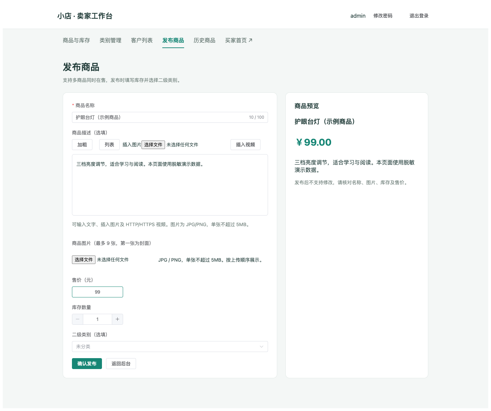

# 范与恒 · 迭代 3 卖家后台实现与页面展示

负责模块：前端卖家后台。第 3 次评审负责第 9 页容器化部署讲述、第 10 页卖家侧演示。

本轮代码成果：[PR #16：商品、类别、库存与客户管理](https://github.com/Ghhhh92/onlineshop/pull/16) ｜ [PR #17：富媒体编辑展示与客户历史验收](https://github.com/Ghhhh92/onlineshop/pull/17)，均已合并。

以下截图来自本轮实际 Vue 页面，使用模拟接口、示例商品和脱敏客户资料；展示界面与交互，不代表真实订单或真实数据库联调结果。

## 1. 多商品列表与筛选（US-31）

将原来的单商品后台升级为多商品分页列表，集中展示类别、价格、状态、库存和发布时间。支持状态与二级类别筛选，逐商品查看意向人。发布页移除前端单件在售限制。

## 2. 库存维护（US-33）

卖家可以填写调整后的库存总数，限制为 1～99999 的整数；保存后重新获取列表，展示后端返回的库存和状态。售罄补货后恢复在售，已下架终态禁用库存维护；业务状态由后端最终校验。

## 3. 两级类别管理（US-32）

提供一级、二级类别树及新增、重命名、排序、确认删除操作。删除约束与同级重名交由后端判断，失败时保留表单，便于修改后重试。

## 4. 注册客户与购买历史（US-38）

客户列表按页展示用户名、电话、默认交易地点、注册时间。逐客户查看分页购买历史，保留成功与失败记录，补充商品不存在提示和交易结果兜底。加载失败支持重试，无客户时展示空列表。

## 5. 多图发布与富文本描述（US-35）

发布时填写库存并选择二级类别；支持最多 9 张 JPG/PNG 商品图片，单张不超过 5MB，第一张为封面，可前移和移除。上传期间禁止发布，失败保留输入。

富文本编辑器支持加粗、列表、本地图片插入和 HTTP/HTTPS 视频嵌入。发布预览与买家详情复用同一套富文本过滤和渲染规则；买家详情图片支持手动左右切换。视频能否播放取决于地址可访问性与格式支持。

## 6. 评审讲述与演示顺序

- 第 9 页：结合项目现有 Dockerfile、compose 和 nginx 配置，讲述前后端两阶段构建、MySQL + 后端 + 前端编排，以及 `/api` 反向代理。本轮上述两个 PR 的主要交付为前端功能，不将现有部署配置计为这两个 PR 的新增工作。
- 第 10 页：发布商品并填写库存、类别 → 查看多商品列表 → 维护二级类别 → 对售罄商品补货 → 打开客户列表及成功、失败购买历史。
- 配合买家侧演示多图详情与富文本展示，说明前后端接口衔接。

## 7. 验证与交付范围

PR #16 记录已通过 Vite 生产构建、Playwright 隔离冒烟及 `git diff --check`，覆盖库存、类别、失败订单、多图排序、发布请求和移动端布局。PR #17 记录已通过生产构建、客户专项隔离测试及差异检查，覆盖客户四项字段、成功/失败记录、错误重试和空列表。

这些前端测试使用模拟响应；不把它们表述为真实数据库端到端验收。具体实现见 `frontend/tests/seller-iteration3.cjs`、`frontend/tests/seller-customers.cjs`。

返回：[第3次评审 · 讲述分工](https://github.com/Ghhhh92/onlineshop/wiki/第3次评审-讲述分工)。
