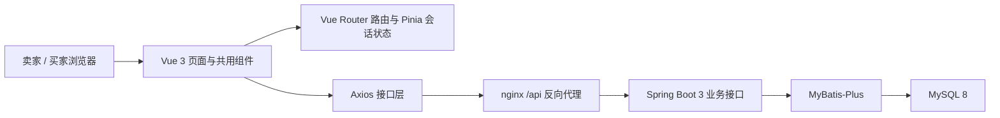

# 范与恒 · 迭代 3 卖家后台实现与页面展示

负责模块：前端卖家后台。第 3 次评审负责第 9 页容器化部署讲述、第 10 页卖家侧演示。

本轮代码成果：[PR #16：商品、类别、库存与客户管理](https://github.com/Ghhhh92/onlineshop/pull/16) ｜ [PR #17：富媒体编辑展示与客户历史验收](https://github.com/Ghhhh92/onlineshop/pull/17)，均已合并。

以下截图来自本轮实际 Vue 页面，使用模拟接口、示例商品和脱敏客户资料；展示界面与交互，不代表真实订单或真实数据库联调结果。

## 架构介绍与模型协作（汇报开场）

### 系统架构：页面、接口与数据分层

项目采用前后端分离架构。我的工作集中在卖家端的页面组织、状态管理、接口调用和交互验证，同时与后端提供的商品、类别、库存、客户接口对接。

| 层次 | 使用技术 | 在本轮中的作用 |
| --- | --- | --- |
| 页面与交互 | Vue 3 Composition API、Element Plus | 商品分页筛选、两级类别维护、库存弹窗、客户历史及发布表单 |
| 路由与会话 | Vue Router、Pinia | 进入卖家页面前恢复会话，拦截未登录访问；统一处理登录失效 |
| 接口与异步状态 | Axios、共用 API 封装 | 统一处理响应和错误；列表维护加载、空数据、失败重试状态，通过请求序号避免旧响应覆盖新结果 |
| 富媒体组件 | RichEditor、RichDescription、DOMParser 白名单过滤 | 描述编辑与展示复用过滤规则，支持图片与视频直链；去除脚本和不允许的属性 |
| 后端与数据（团队架构） | Java 17、Spring Boot 3、MyBatis-Plus、MySQL 8、Flyway | 后端执行类别删除约束、库存与商品状态规则；Flyway 管理表结构版本 |
| 构建、部署与验证 | Vite、Docker Compose、nginx、Playwright | 生产打包、容器编排与反向代理；隔离浏览器测试验证主要交互 |

**以“售罄补货”为例说明协作链路：**卖家在 Vue 弹窗输入库存 → 前端校验整数范围 → API 层提交库存请求 → 后端校验并更新库存与商品状态 → 前端重新查询列表展示结果。前端负责交互和反馈，库存状态规则在后端执行。

### 与 AI 模型的开发协作

本轮采用“需求约束 → 模型辅助实现 → 检查与验证 → PR 交付”的协作方式。模型辅助梳理已有代码、编写页面和接口适配、生成隔离测试及整理文档；汇报时结合具体代码与测试结果说明完成情况。

| 协作环节 | 提供给模型的上下文与约束 | 可核对的产出 |
| --- | --- | --- |
| 需求拆解 | 迭代三任务、已有卖家页面、后端接口契约 | 将商品、类别、库存、客户和富媒体需求映射到页面、字段与交互 |
| 实现与修订 | 复用现有 Vue 技术栈、会话守卫和 API 封装；按后端字段提交 | PR #16 的后台管理页面，以及 PR #17 的富媒体编辑和客户历史补充 |
| 验证反馈 | 为典型成功、失败、空列表与重试场景设置模拟响应 | Playwright 隔离测试、Vite 构建及差异检查；发现问题后继续修订 |
| 成果说明 | 根据已合并 PR 和实际页面组织材料 | 本文的功能说明、脱敏截图及演示顺序 |

**汇报可这样开场：**“这次我把卖家后台从单商品页面扩展成多商品管理，并按页面、会话状态、接口和业务规则组织实现。我与 AI 模型协作时，先提供需求和接口约束，再结合生成的代码、浏览器测试与构建结果逐项核对，最后通过 PR 交付。下面用库存补货和客户购买历史说明具体技术链路。”

## 1. 多商品列表与筛选（US-31）

将原来的单商品后台升级为多商品分页列表，集中展示类别、价格、状态、库存和发布时间。支持状态与二级类别筛选，逐商品查看意向人。发布页移除前端单件在售限制。

## 2. 库存维护（US-33）

卖家可以填写调整后的库存总数，限制为 1～99999 的整数；保存后重新获取列表，展示后端返回的库存和状态。售罄补货后恢复在售，已下架终态禁用库存维护；业务状态由后端最终校验。

## 3. 两级类别管理（US-32）

提供一级、二级类别树及新增、重命名、排序、确认删除操作。删除约束与同级重名交由后端判断，失败时保留表单，便于修改后重试。

## 4. 注册客户与购买历史（US-38）

客户列表按页展示用户名、电话、默认交易地点、注册时间。逐客户查看分页购买历史，保留成功与失败记录，补充商品不存在提示和交易结果兜底。加载失败支持重试，无客户时展示空列表。

## 5. 多图发布与富文本描述（US-35）

发布时填写库存并选择二级类别；支持最多 9 张 JPG/PNG 商品图片，单张不超过 5MB，第一张为封面，可前移和移除。上传期间禁止发布，失败保留输入。

富文本编辑器支持加粗、列表、本地图片插入和 HTTP/HTTPS 视频嵌入。发布预览与买家详情复用同一套富文本过滤和渲染规则；买家详情图片支持手动左右切换。视频能否播放取决于地址可访问性与格式支持。

## 6. 评审讲述与演示顺序

- 第 9 页：结合项目现有 Dockerfile、compose 和 nginx 配置，讲述前后端两阶段构建、MySQL + 后端 + 前端编排，以及 `/api` 反向代理。本轮上述两个 PR 的主要交付为前端功能，不将现有部署配置计为这两个 PR 的新增工作。
- 第 10 页：发布商品并填写库存、类别 → 查看多商品列表 → 维护二级类别 → 对售罄商品补货 → 打开客户列表及成功、失败购买历史。
- 配合买家侧演示多图详情与富文本展示，说明前后端接口衔接。

## 7. 验证与交付范围

PR #16 记录已通过 Vite 生产构建、Playwright 隔离冒烟及 `git diff --check`，覆盖库存、类别、失败订单、多图排序、发布请求和移动端布局。PR #17 记录已通过生产构建、客户专项隔离测试及差异检查，覆盖客户四项字段、成功/失败记录、错误重试和空列表。

这些前端测试使用模拟响应；不把它们表述为真实数据库端到端验收。具体实现见 `frontend/tests/seller-iteration3.cjs`、`frontend/tests/seller-customers.cjs`。

返回：[第3次评审 · 讲述分工](https://github.com/Ghhhh92/onlineshop/wiki/第3次评审-讲述分工)。
