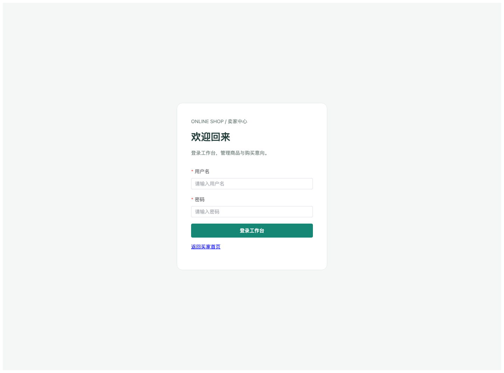
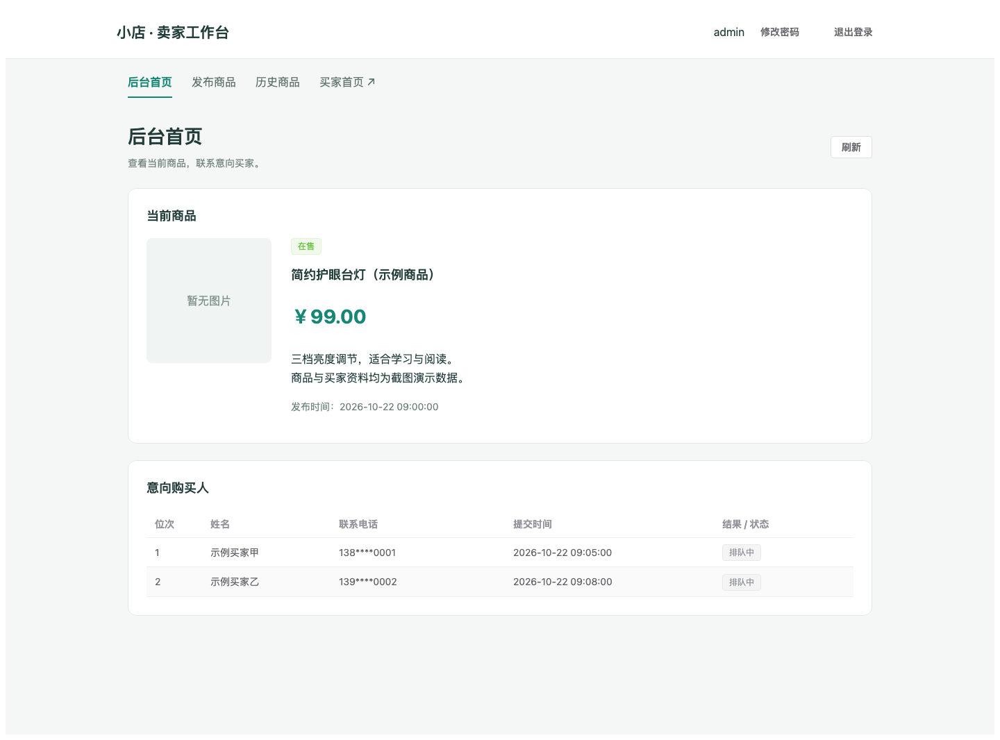
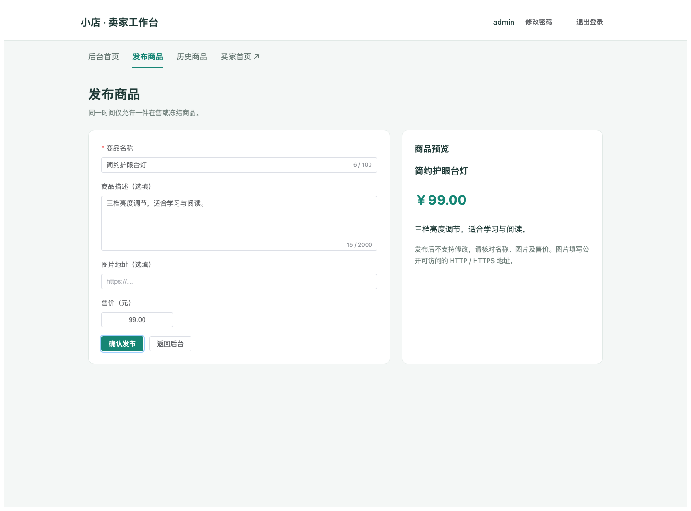
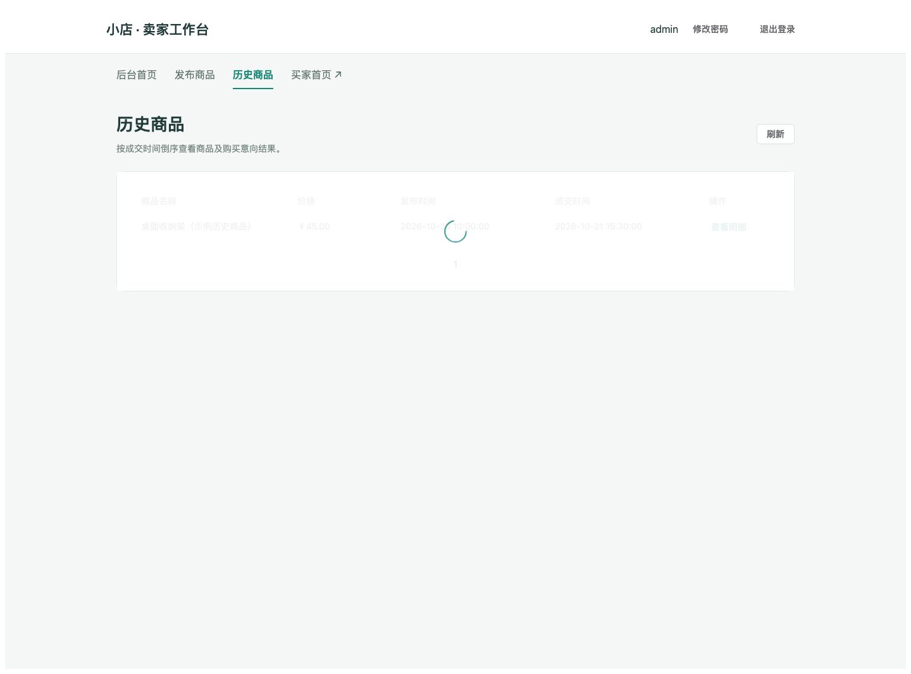
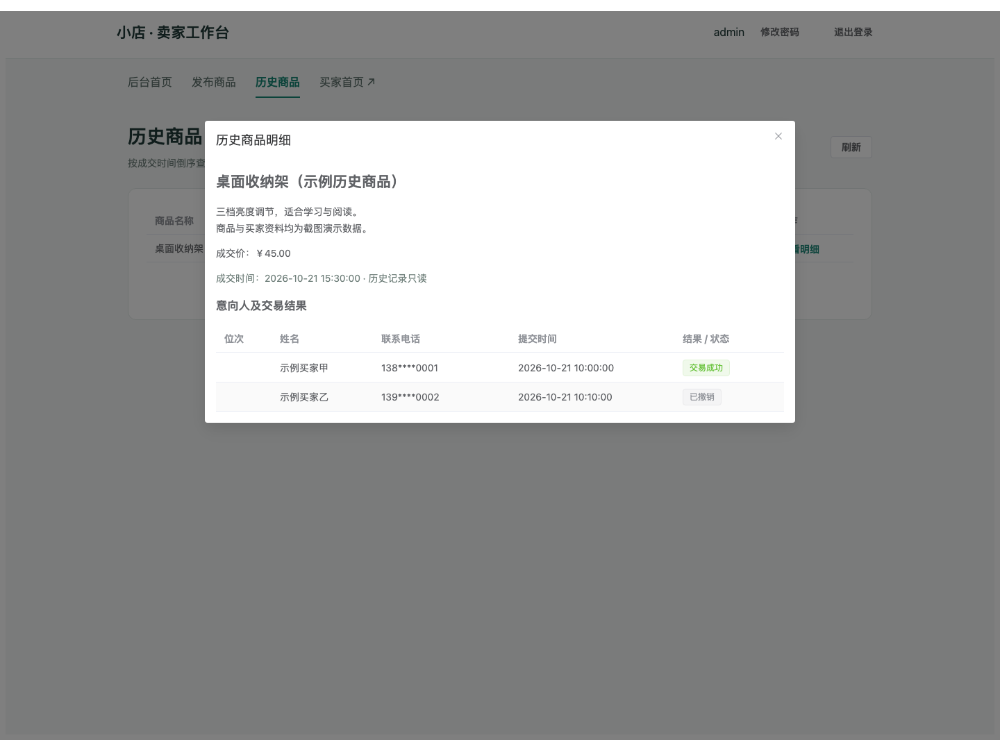

# 范与恒 · 卖家工作台页面展示

负责模块：前端卖家后台。第 2 次评审负责第 10 页卖家侧演示。

以下为实际 Vue 页面在浏览器中的截图，统一使用示例商品及示例买家，电话号码已脱敏。截图只展示界面与交互布局，不代表真实交易记录，也不替代真实后端联调。

## 1. 卖家登录

用户名、密码校验，失败提示及成功跳转。通过 `/seller/me` 恢复有效会话，统一处理登录失效。

## 2. 后台首页：商品与意向购买人

展示当前商品名称、价格、描述和在售/冻结状态。意向购买人按提交先后展示，卖家可以查看姓名、电话与位次。公开截图中的姓名为示例，电话已脱敏。

## 3. 发布商品

名称、价格必填，描述和图片选填；提供输入校验和商品预览。页面提示单件在售限制，后端执行最终业务校验。

## 4. 历史商品列表

已下架商品按成交时间倒序分页展示，可查看商品明细。以下历史商品为演示数据；成交/失败标记操作接口仍在后续迭代范围。

## 5. 历史商品明细

只读展示商品信息及关联意向人的结果，便于后续追溯。以下成功/撤销状态均为示例数据。

## 个人实现与演示顺序

- 四个卖家页面及共用导航、账号操作和意向人表格。
- 会话恢复、401 处理、接口暂缺时的 404/405 提示或降级。
- 第 10 页演示：登录、发布商品，配合买家端提交意向后，在后台查看意向购买人。
- 代码成果：[PR #6：完善卖家后台四页面与会话管理](https://github.com/Ghhhh92/onlineshop/pull/6)。
- 返回：[第 2 次评审讲述分工](https://github.com/Ghhhh92/onlineshop/wiki/第2次评审-讲述分工)。
